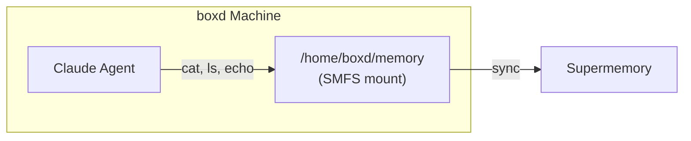
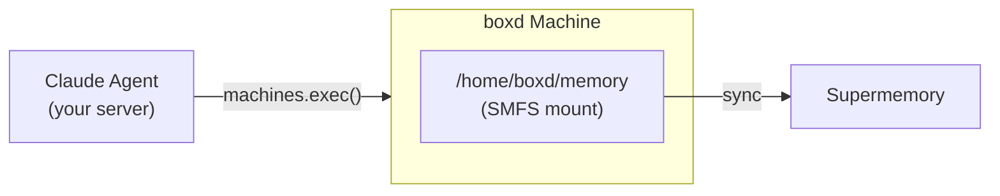

Mount a Supermemory container inside a [boxd](https://boxd.sh?ref=supermemory)
machine so your agent can read and write memory using standard filesystem
commands. A boxd machine is a full Ubuntu VM with FUSE, Python, `uv` and
`systemd`, so SMFS runs there without a custom image.

## How it works

There are two ways to wire SMFS into a boxd machine. Pick the one that fits
your architecture.

### Agent inside the machine

The agent process runs inside the machine and accesses the SMFS mount
directly. Your orchestrating code creates the machine, mounts memory and starts
the agent.



### Agent outside the machine

The agent runs in your orchestrating code and executes commands inside the
machine remotely.



## Prerequisites

- A [Supermemory API key](https://supermemory.ai)
- A [boxd API key](https://docs.boxd.sh/cli/authentication?ref=supermemory#api-keys)
  in `BOXD_API_KEY`
- An [Anthropic API key](https://console.anthropic.com) (Pattern A only)
- The boxd SDK: `pip install boxd` or `npm install @boxd-sh/sdk`

---

## Install and mount SMFS in a boxd machine

Both patterns below run the same snippets inside the machine. `SMFS_INSTALL`
installs SMFS and allows FUSE mounts for other users. `SMFS_MOUNT` signs in and
starts the mount as a `systemd` unit, so it keeps running after the command
returns. `systemd-run` returns once SMFS reports the mount is ready. Then
`SMFS_OWN` gives the `boxd` user write access to the mount.

<Tabs>
  <Tab title="Python">
    ```python
    SMFS_INSTALL = (
        "curl -fsSL https://smfs.ai/install | bash -s -- 0.0.5 && "
        "echo 'user_allow_other' | sudo tee -a /etc/fuse.conf > /dev/null"
    )

    SMFS_MOUNT = (
        '/home/boxd/.local/bin/smfs login --key "$SUPERMEMORY_API_KEY" && '
        "sudo systemd-run --unit smfs-my_agent -p Type=forking --uid=boxd --gid=boxd "
        "--setenv=HOME=/home/boxd /home/boxd/.local/bin/smfs mount my_agent "
        "--ephemeral --path /home/boxd/memory"
    )

    SMFS_OWN = "sudo chown boxd:boxd /home/boxd/memory"
    ```
  </Tab>
  <Tab title="TypeScript">
    ```typescript
    const SMFS_INSTALL =
      "curl -fsSL https://smfs.ai/install | bash -s -- 0.0.5 && " +
      "echo 'user_allow_other' | sudo tee -a /etc/fuse.conf > /dev/null";

    const SMFS_MOUNT =
      '/home/boxd/.local/bin/smfs login --key "$SUPERMEMORY_API_KEY" && ' +
      "sudo systemd-run --unit smfs-my_agent -p Type=forking --uid=boxd --gid=boxd " +
      "--setenv=HOME=/home/boxd /home/boxd/.local/bin/smfs mount my_agent " +
      "--ephemeral --path /home/boxd/memory";

    const SMFS_OWN = "sudo chown boxd:boxd /home/boxd/memory";
    ```
  </Tab>
</Tabs>

---

## Pattern A: Agent inside the machine

### Agent code

```python agent.py
import asyncio
from claude_agent_sdk import query, ClaudeAgentOptions

MEMORY = "/home/boxd/memory"

async def main():
    async for message in query(
        prompt=f"You have a persistent memory filesystem at {MEMORY}. "
               "Read profile.md to learn about the user, then create "
               "session_notes.md summarizing what you found.",
        options=ClaudeAgentOptions(
            allowed_tools=["Bash", "Read", "Write"],
            cwd=MEMORY,
        ),
    ):
        print(message)

asyncio.run(main())
```

### Orchestration

<Tabs>
  <Tab title="Python">
    ```python run.py
    import os
    from pathlib import Path
    from boxd import Boxd

    client = Boxd(api_key=os.environ["BOXD_API_KEY"])
    machine = client.machines.create(isolated=True)
    client.machines.wait_until_ready(machine.id)

    # Pass keys per command with env
    env = {
        "SUPERMEMORY_API_KEY": os.environ["SUPERMEMORY_API_KEY"],
        "ANTHROPIC_API_KEY": os.environ["ANTHROPIC_API_KEY"],
    }

    # See "Install and mount SMFS in a boxd machine" above
    client.machines.exec(machine.id, SMFS_INSTALL, timeout=120)
    client.machines.exec(machine.id, ["sh", "-c", SMFS_MOUNT], env=env, timeout=60)
    client.machines.exec(machine.id, SMFS_OWN)

    # Upload and run the agent
    client.machines.files.upload(
        machine.id, "/home/boxd/agent.py", Path("agent.py").read_bytes()
    )
    result = client.machines.exec(
        machine.id,
        ["uv", "run", "--with", "claude-agent-sdk", "python3", "/home/boxd/agent.py"],
        env=env,
        timeout=300,
    )
    print(result.stdout)

    client.machines.delete(machine.id)
    ```
  </Tab>
  <Tab title="TypeScript">
    ```typescript run.ts
    import { Boxd } from "@boxd-sh/sdk";
    import { readFileSync } from "fs";

    const boxd = new Boxd({ apiKey: process.env.BOXD_API_KEY! });
    const machine = await boxd.machines.create({ isolated: true });
    await boxd.machines.waitUntilReady(machine.id);

    // Pass keys per command with env
    const env = {
      SUPERMEMORY_API_KEY: process.env.SUPERMEMORY_API_KEY!,
      ANTHROPIC_API_KEY: process.env.ANTHROPIC_API_KEY!,
    };

    // See "Install and mount SMFS in a boxd machine" above
    await boxd.machines.exec(machine.id, { command: SMFS_INSTALL, timeout: 120_000 });
    await boxd.machines.exec(machine.id, {
      command: ["sh", "-c", SMFS_MOUNT],
      env,
      timeout: 60_000,
    });
    await boxd.machines.exec(machine.id, { command: SMFS_OWN });

    // Upload and run the agent
    await boxd.machines.files.upload(
      machine.id,
      "/home/boxd/agent.py",
      readFileSync("agent.py"),
    );
    const result = await boxd.machines.exec(machine.id, {
      command: ["uv", "run", "--with", "claude-agent-sdk", "python3", "/home/boxd/agent.py"],
      env,
      timeout: 300_000,
    });
    console.log(result.stdout);

    await boxd.machines.delete(machine.id);
    ```
  </Tab>
</Tabs>

---

## Pattern B: Agent outside the machine

The agent runs in your server process and executes commands inside the
machine remotely with `machines.exec()`. The SMFS mount lives inside the
machine; the agent never touches the filesystem directly.

<Tabs>
  <Tab title="Python">
    ```python run.py
    import os
    from boxd import Boxd

    client = Boxd(api_key=os.environ["BOXD_API_KEY"])
    machine = client.machines.create(isolated=True)
    client.machines.wait_until_ready(machine.id)

    env = {"SUPERMEMORY_API_KEY": os.environ["SUPERMEMORY_API_KEY"]}

    # See "Install and mount SMFS in a boxd machine" above
    client.machines.exec(machine.id, SMFS_INSTALL, timeout=120)
    client.machines.exec(machine.id, ["sh", "-c", SMFS_MOUNT], env=env, timeout=60)
    client.machines.exec(machine.id, SMFS_OWN)

    # Agent runs here and executes commands in the machine
    profile = client.machines.exec(machine.id, "cat /home/boxd/memory/profile.md")
    print("Profile:", profile.stdout)

    client.machines.exec(
        machine.id,
        'echo "Session started at $(date)" > /home/boxd/memory/session_notes.md',
    )

    files = client.machines.exec(machine.id, "ls /home/boxd/memory")
    print("Files:", files.stdout)

    client.machines.delete(machine.id)
    ```
  </Tab>
  <Tab title="TypeScript">
    ```typescript run.ts
    import { Boxd } from "@boxd-sh/sdk";

    const boxd = new Boxd({ apiKey: process.env.BOXD_API_KEY! });
    const machine = await boxd.machines.create({ isolated: true });
    await boxd.machines.waitUntilReady(machine.id);

    const env = { SUPERMEMORY_API_KEY: process.env.SUPERMEMORY_API_KEY! };

    // See "Install and mount SMFS in a boxd machine" above
    await boxd.machines.exec(machine.id, { command: SMFS_INSTALL, timeout: 120_000 });
    await boxd.machines.exec(machine.id, {
      command: ["sh", "-c", SMFS_MOUNT],
      env,
      timeout: 60_000,
    });
    await boxd.machines.exec(machine.id, { command: SMFS_OWN });

    // Agent runs here and executes commands in the machine
    const profile = await boxd.machines.exec(machine.id, {
      command: "cat /home/boxd/memory/profile.md",
    });
    console.log("Profile:", profile.stdout);

    await boxd.machines.exec(machine.id, {
      command: `echo "Session started at $(date)" > /home/boxd/memory/session_notes.md`,
    });

    const files = await boxd.machines.exec(machine.id, {
      command: "ls /home/boxd/memory",
    });
    console.log("Files:", files.stdout);

    await boxd.machines.delete(machine.id);
    ```
  </Tab>
</Tabs>

---

## Tips

- `isolated: true` keeps the machine off your org's private network. Use it
  when the agent runs code you don't control
- Use `--ephemeral` for machine mounts: it keeps the cache in memory only,
  but writes still push to Supermemory
- Use `smfs grep 'query'` for semantic search across all files in the
  container
- Check the mount with `systemctl status smfs-my_agent`, and stop it with
  `sudo systemctl stop smfs-my_agent`
- To keep a machine between sessions, call `machines.hibernate()` instead of
  `machines.delete()` and `machines.wake()` when you need it again. The mount
  is still there after the wake, so you don't run the setup again
